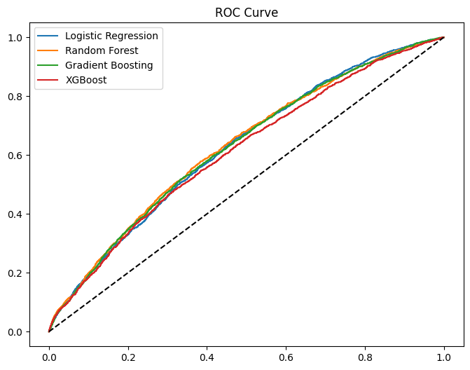
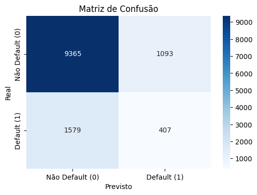

# Risco de Crédito Nubank 

  

# 1. Sobre o projeto

- Este projeto tem como objetivo desenvolver um modelo de Machine Learning para previsão de inadimplência **(Credit Default Prediction)**, simulando um cenário real de análise de risco de crédito em uma instituição financeira.

- O trabalho segue a metodologia **CRISP-DM**, passando pelas etapas de entendimento do problema, exploração dos dados, preparação, modelagem, avaliação e interpretação dos resultados. Todo o processo foi desenvolvido em Python, utilizando boas práticas de ciência de dados e construção de pipelines reprodutíveis.

- O conjunto de dados contém aproximadamente **45.000** registros e **43** variáveis, representando informações financeiras, cadastrais e comportamentais dos clientes, como score de crédito, limite disponível, renda, histórico de empréstimos, consultas realizadas por provedores externos, entre outras.

# Problema de negócio e objetivo do projeto

- O principal objetivo é prever a variável **target_default**, identificando clientes com maior probabilidade de inadimplência antes da concessão de crédito, auxiliando na tomada de decisão e reduzindo perdas financeiras.

# Etapas do projeto

## 1. Análise Exploratória dos Dados (EDA)

Durante a análise exploratória foram realizadas diversas etapas para compreender a qualidade dos dados e identificar padrões relevantes:

- Análise de valores ausentes (Missing Values);
- Tratamento de registros inconsistentes;
- Correção de valores inválidos (como limites de crédito iguais a zero e rendas infinitas);
- Identificação e tratamento de outliers;
- Análise univariada e bivariada;
- Estatísticas descritivas;
- Matriz de Correlação de Pearson;
- Análise de Multicolinearidade utilizando VIF;
- Construção de perguntas de negócio para geração de insights.

Além das análises estatísticas, foram investigadas relações entre variáveis como **Score de Crédito**, **Risk Rate**, **Renda**, **Limite de Crédito**, **Histórico de Empréstimos** e consultas realizadas por provedores externos.

## 2. Feature Engineering

Foram criadas novas variáveis com o objetivo de melhorar a capacidade preditiva dos modelos, incluindo:

- Transformação da variável alvo para formato binário;
- Tratamento de variáveis categóricas;
- Imputação de valores ausentes;
- Padronização das variáveis numéricas;
- Criação de categorias de Score de Crédito;
- Preparação completa dos dados utilizando Pipelines do Scikit-Learn.

## 3. Modelagem

Foram treinados e comparados diferentes algoritmos de Machine Learning:

- Regressão Logística
- Random Forest
- Gradient Boosting
- XGBoost

Todos os modelos foram treinados utilizando um pipeline único de pré-processamento, garantindo que as transformações fossem aplicadas corretamente tanto nos dados de treino quanto de teste.

## 4. Avaliação

Os modelos foram comparados utilizando métricas amplamente empregadas em problemas de risco de crédito:

- Curva ROC
- Estatística KS (Kolmogorov-Smirnov)
- Comparação entre modelos

Após a avaliação, foi selecionado o modelo com melhor desempenho para análise detalhada.

## 5. Interpretabilidade

- Para aumentar a transparência das previsões foi utilizada a técnica de interpretabilidade **Feature Importance**.

- Essa análise permitiu compreender quais variáveis exerceram maior influência nas decisões do modelo.

# Análise Exploratória dos Dados 

## Análise Inicial dos Dados

- O dataset possui **43** variáveis e **45.000** registros.
- Dessas **43** variáveis, **8** possuem mais de **10%** de valores missing, **target_fraud** é a variável com a maior porcentagem de valores ausentes **(96.6%)**, em segundo e terceiro lugar temos as variáveis **last_amount_borrowed** e **last_borrowed_in_months** com **(66.5%)** de valores ausentes.
- A variável **target_fraud** mostra se existe ou não fraude de cartão de crédito. Nesse caso essa variável não é importante para o projeto.Portanto, esta coluna será excluída.
- As variáveis **last_amount_borrowed**, **last_borrowed_in_months**, **ok_since** e **external_data_provider_credit_checks_last_2_year** possuem mais de 50% de valores ausentes, substituir esses valores é algo difícil, manter elas pode gerar erros durante a predição. Portanto, estas colunas serão excluídas.
- As variáveis **job_name**, **external_data_provider_first_name**, **profile_phone_number** e **zip** são variáveis insignificantes para o projeto, portanto serão excluídas.
- A variável **external_data_provider_email_seen_before** possui um valor mínimo de -999.000000, certamente foi um erro, nesse caso, vamos alterar para o tipo NaN.
- A variável **reported_income** possui um valor máximo descrito como inf(infinito), nesse caso, vamos alterar para o tipo NaN.
- A variável **credit_limit** possui um valor mínimo de 0.000000, isso não existe em instituições financeiras, é obrigatório liberar um valor X de crédito para o cliente. Portanto, este valor será substituído por NaN.
- As variáveis:
    - **ids**, **score_1**, **score_2**, **reason**, **facebook_profile**, **state**, **zip**, **channel**, **job_name**, **real_state**,
**email**, **external_data_provider_first_name**, **lat_lon**, **marketing_channel**, **external_data_provider_email_seen_before**,
**application_time_in_funnel**, **application_time_applied**, **external_data_provider_fraud_score**, **profile_phone_number**, **shipping_zip_code**, **profile_tags**, **user_agent**, e **target_fraud** são variáveis com valores não significantes para o projeto, portanto serão excluídas.

## Relatório Análise Univariada

- Entre os **Scores**, o Score 3 é o mais diversificado para uma análise bi e multivariada, onde o score **340.0** é o valor mais frequente.

- Em **Risk Rate** o valor de **0.29** é o valor mais frequente, onde o valor máximo registrado é de **0.57**.

- Em **Last Amount Borrowed** o valor de **12,024.02** é o mais frequente, e praticamente isolado, pois em segundo lugar vem o valor de 10022.75 com apenas 3 registros.

- Em **Last Borrowed in Months** **36,0** meses é o intervalo com mais frequência.

- Em **Credit Limit** o valor de **29,942.00** é o valor mais frequente, e praticamente isolado, pois em segundo lugar vem o valor de **10,000.0** com apenas **107** registros.

- Em **Income** o valor de **60,022.37** é o mais frequente, e praticamente isolado, pois em segundo lugar vem o valor de **75,017.74** com apenas 5 registros.

- Em **Ok Since** temos o valor de **32,0** com mais frequência e praticamente isolado, com **20,084** registros.

- Em **N Bankruptcies** podemos ver que os clientes não tiveram declaração de falência.

- Em **N Defaulted Loans** podemos ver que número de empréstimos não possuem inadimplência.

- Em **N Accounts** podemos ver que grande parte dos clientes possuem mais de **5** a **10** contas ou créditos em seus nomes.

- Em **N Issues** podemos ver que **10** problemas ou ocorrências, irregularidades associadas as contas dos clientes são mais frequentes, seguidas de 9, 8 e 11 ocorrências.

- Em **External Data Provider Credit Checks Last 2 Years** possuem **0** quantidade de consultas.

- **External Data Provider Credit Checks Last Month** já é um pouco diferente. **2** é o números mais frequente de vezes que provedores externos consultaram o histórico de crédito no mês anterior.

- Em **External Data Provider Credit Checks Last Year** **1** que siginica True é o numero com mais frequência em consultas dos dados históricos de crédito.

- Em **Reported Income** o valor de 100,720.00 é o mais frequente. Em segundo lugar vem o valor de 26,601.00.

- Em **Shipping State** é basicamente o registro dos estados onde se localizam cada cliente. **SP** é o estado com mais frequência.

- E em **Target Default** podemos ver que há mais registros **positivos** com relação aos créditos.

## Relatório Análise Bivariada 

Sobre as correlações feitas com **Diagramas de Dispersão**, **Correlação de Pearson**, e verificação de **Multicolinearidade** utilizando **VIF(Variance Inflation Factor)**:

- Não foi detectado correlações significativas entre as variáveis utilizando a técnica Correlação de Pearson. 

- As Correlações de Pearson ficaram abaixo de **0.50**, apenas duas variáveis tiveram um valor de **0.84**. 

- No teste do VIF, os valores de quase todas as variáveis ficaram abaixo de **5.0**, que é o aceitável para a inexistência de multicolinearidade, e correlação, apenas a variável last_borrowed_in_months ficou com valor de 1,222.99, provavelmente é um erro.

**Perguntas de Negócio**

Foram criadas perguntas de negócio iniciais para os ****Médios - Score 3 de 301 até 700****, que significa um médio risco de inadimplência. 

Com isso detectamos as seguintes informações:

- Há clientes com **Médios - Score 3 de 301 até 700** que possuem **Risk Rate maior do que 0.50**, significando um certo risco de inadimplência.

- Há clientes com **Médios - Score 3 de 301 até 700** que fizeram últimos empréstimos maiores que **20.000**.

- Há clientes com **Médios - Score 3 de 301 até 700** com limite de crédito maior que **50.000**.

- Há clientes com **Médios - Score 3 de 301 até 700** com Renda entre **10.000 a 30.000**.

- Há clientes com **Médios - Score 3 de 301 até 700** com **OK Since** entre **5 meses a 10 meses**. Isso significa que há possível inadimplência.

- Há clientes com **Médios - Score 3 de 301 até 700** com 0 registros de falência.

- Há clientes com **Médios - Score 3 de 301 até 700** que possuem mais de **1 conta**.

- Há clientes com **Médios - Score 3 de 301 até 700** que possuem problemas (n_issues) maiores do que **1**.

- Há clientes com **Médios - Score 3 de 301 até 700** que possuem o "número de vezes que um provedor de dados externo realizou uma verificação de crédito sobre uma pessoa no último mês."**(external_data_provider_credit_checks_last_month)** maiores do que **1**. Isso significa que houve checagem na verificação de crédito.

- Há clientes com **Médios - Score 3 de 301 até 700** que possuem "número de vezes que um provedor de dados externo realizou uma verificação de crédito sobre uma pessoa no último ano."(**external_data_provider_credit_checks_last_year**) igual a 1. Isso também significa que houve checagem na verificação de crédito.

- Há clientes com **Médios - Score 3 de 301 até 700** que possuem Renda Reportada maior que **100.000**.

- Há clientes com **Médios - Score 3 de 301 até 700** que estão em outros estados além de **SP**.

- Há clientes com **Médios - Score 3 de 301 até 700** que posseum inadimplência **(target_default = 1)**.

# Modelagem

## Objetivo

O notebook **modelling_novo.ipynb** reúne todo o processo de construção, treinamento e avaliação de modelos de Machine Learning para previsão de inadimplência **(Credit Default Prediction)**. O objetivo é identificar clientes com maior probabilidade de entrar em **default**, auxiliando a tomada de decisão na concessão de crédito.

## Fluxo do projeto

### 1. Importação das bibliotecas

Inicialmente foram importadas as principais bibliotecas utilizadas no projeto, incluindo:

- Pandas e NumPy para manipulação dos dados;
- Matplotlib para visualizações;
- Scikit-Learn para pré-processamento, construção de pipelines, treinamento e avaliação dos modelos;

### 2. Carregamento dos dados

O conjunto de dados é carregado a partir do arquivo **acquisition_train.csv**, contendo informações cadastrais, financeiras e comportamentais dos clientes.

Também é realizada uma inspeção inicial da base para verificar:

- tipos das variáveis;
- quantidade de registros;
- presença de valores ausentes.

### 3. Limpeza dos dados

Nesta etapa são removidas variáveis que não agregam valor ao modelo, incluindo:

- identificadores;
- informações de localização;
- dados pessoais;
- variáveis relacionadas à fraude;
- colunas com baixa utilidade preditiva.

Também são tratados registros inconsistentes, como valores extremamente elevados de renda informada **(reported_income)**.

### 4. Feature Engineering

Para aumentar o poder preditivo dos modelos foram criadas novas variáveis derivadas, entre elas:

**Debt-to-Income**

Relação entre o valor do último empréstimo e a renda do cliente.

Esta variável representa o comprometimento da renda com dívidas.

**Credit Utilization**

Relação entre o último valor emprestado e o limite de crédito disponível.

Essa métrica indica o nível de utilização do crédito concedido.

**Total Negatives**

Soma de indicadores negativos do histórico do cliente, como:

quantidade de falências;
empréstimos inadimplentes;
ocorrências negativas.

**Income Log**

Aplicação da transformação logarítmica na renda para reduzir assimetria da distribuição.

**Score Mean**

Média dos diferentes scores disponíveis na base, sintetizando informações provenientes de múltiplas fontes.

Após a criação dessas variáveis, algumas colunas originais são removidas para evitar redundância e reduzir multicolinearidade.

### 5. Separação dos dados

Os dados são divididos em:

- Variáveis explicativas **(X)**
- Variável alvo **(target_default)**

Em seguida é realizado o **Train/Test Split**, preservando um conjunto independente para avaliação do desempenho do modelo.

### 6. Pipeline de pré-processamento

Foi construída uma pipeline utilizando o Scikit-Learn, garantindo que todas as etapas de transformação sejam executadas de forma consistente.

**Variáveis numéricas**

- Imputação pela mediana;
- Padronização utilizando StandardScaler.

**Variáveis categóricas**

- Imputação da categoria **Unknown**;
- Codificação utilizando **One-Hot Encoding**.

Todo o pré-processamento é integrado por meio de um **ColumnTransformer**, evitando vazamento de dados **(Data Leakage)**.

### 7. Modelos treinados

Foram comparados quatro algoritmos de classificação:

- Logistic Regression
- Random Forest
- Gradient Boosting
- XGBoost

Para lidar com o desbalanceamento da variável alvo foram utilizadas estratégias específicas:

- class_weight='balanced' na Regressão Logística;
- scale_pos_weight no XGBoost.

### 8. Treinamento

Cada algoritmo é treinado dentro de uma Pipeline composta por:

- Pré-processamento → Modelo

Após o treinamento, é calculada a probabilidade de inadimplência para o conjunto de teste.

### 9. Avaliação dos modelos

O desempenho é comparado utilizando a métrica ROC-AUC e a Matriz de Confusão, amplamente utilizada em problemas de risco de crédito.

Também é construída a Curva ROC para comparação visual entre os modelos.

  

Como métrica principal foi utilizada a curva ROC e a métrica AUC, bastante empregadas em problemas de classificação.

- O modelo **Random Forest** apresentou o melhor desempenho, com **AUC** de aproximadamente **0,63**.

- Apesar de a diferença entre os modelos ser relativamente pequena, o Random Forest conseguiu apresentar maior capacidade de separação entre clientes adimplentes e inadimplentes.

- Vale destacar que esses resultados representam um desempenho moderado, algo esperado considerando as limitações da base de dados disponível.

- Ao analisar a **matriz de confusão**, observamos que o modelo apresentou bom desempenho na identificação de clientes adimplentes.

- O modelo apresentou bom desempenho na identificação de clientes adimplentes, com alta taxa de acerto para a **classe majoritária**.

- Foram identificados **407** **inadimplentes** corretamente, porém ainda houve quantidade relevante de falsos negativos.

- Os resultados evidenciam a necessidade de melhorias no **recall** da classe **inadimplente**.

- **Acurácia** geral de **79%**, influenciada pelo **desbalanceamento** da base.

- A classe adimplente apresentou desempenho elevado **(Precision: 0,86 | Recall: 0,90)**.

- Para inadimplência, o modelo obteve **Precision** de **0,27** e **Recall** de **0,20**.

- O modelo demonstrou maior eficiência na identificação de bons pagadores do que inadimplentes.

- Os resultados demonstram que existe potencial para evolução com novas técnicas de balanceamento e enriquecimento dos dados.

  

### 10. Estatística KS

Além da ROC-AUC, o notebook calcula a Estatística Kolmogorov-Smirnov (KS), bastante utilizada pelo mercado financeiro para avaliar o poder discriminatório de modelos de crédito.

- Novamente o **Random Forest** apresentou o melhor resultado.

- Embora o valor obtido ainda esteja abaixo do observado em modelos utilizados em produção nas instituições financeiras, ele confirma que o algoritmo conseguiu separar melhor clientes de maior e menor risco quando comparado aos demais modelos.

### 11. Seleção do melhor modelo

Após comparar os resultados, o modelo com maior desempenho é automaticamente selecionado para as etapas seguintes de interpretação.

### 12. Feature Importance

Para modelos baseados em árvores é calculada a importância das variáveis (Feature Importance), permitindo identificar quais atributos tiveram maior influência nas previsões.

As variáveis que mais contribuíram para as decisões do modelo Random Forest foram:

- risk_rate
- income_log 
- debt_to_income 
- last_borrowed_in_months
- score_mean

Esses resultados fazem sentido do ponto de vista de negócio, pois renda, nível de endividamento e histórico de crédito são fatores tradicionalmente utilizados na avaliação de risco.

Também foi interessante observar que variáveis criadas durante a Engenharia de Atributos apareceram entre as mais importantes, demonstrando que essa etapa agregou valor ao modelo.

### 13. Credit Score

Ao final do processo, a probabilidade de inadimplência prevista pelo melhor modelo é convertida em um score simplificado:

- maior probabilidade de default → menor score
- menor probabilidade de default → maior score

Esse score serve como uma representação intuitiva do risco de crédito de cada cliente.

### Tecnologias utilizadas

- Python
- Pandas
- NumPy
- Scikit-Learn
- XGBoost
- Matplotlib
- Jupyter Notebook

### Competências demonstradas

- Limpeza de dados
- Feature Engineering
- Machine Learning para classificação
- Construção de Pipelines
- Tratamento de dados categóricos e numéricos
- Balanceamento de classes
- Avaliação de modelos (ROC-AUC e KS)
- Feature Importance
- Interpretabilidade de modelos
- Credit Scoring
- Boas práticas utilizando Scikit-Learn Pipelines

